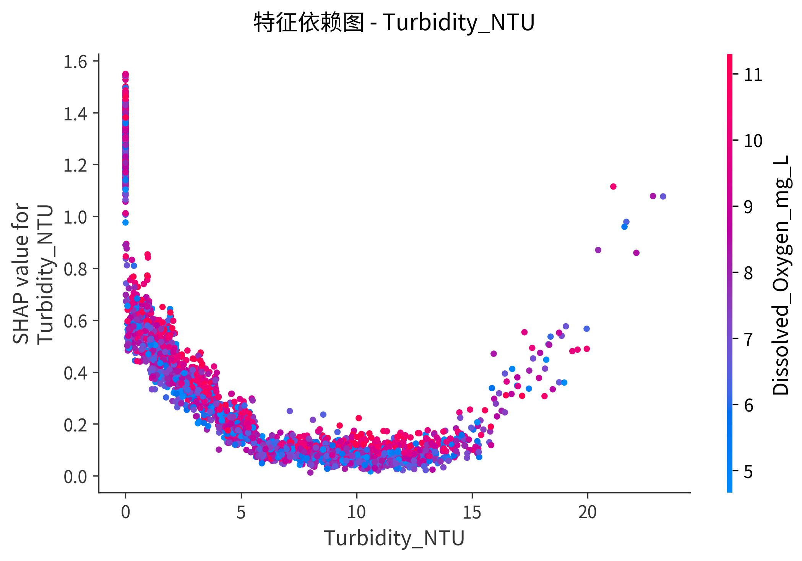
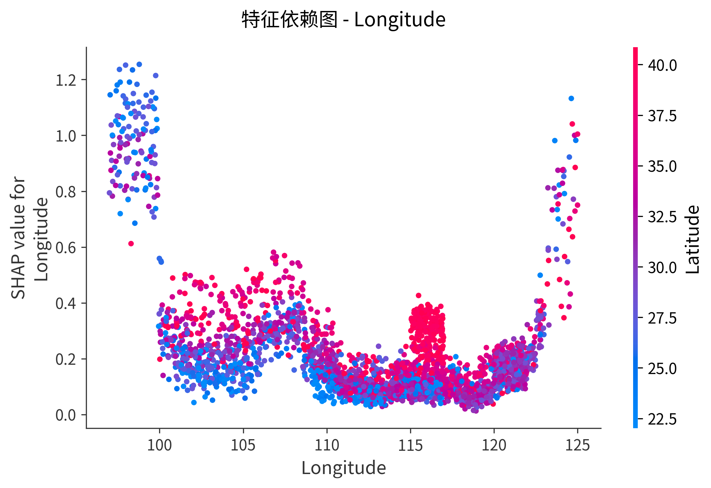
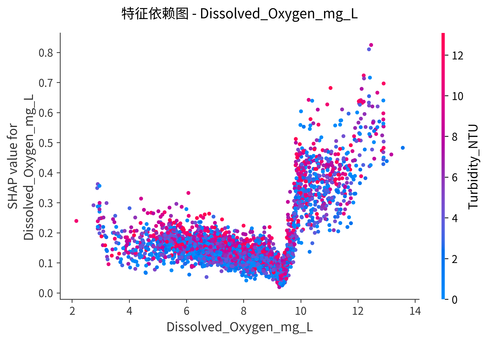
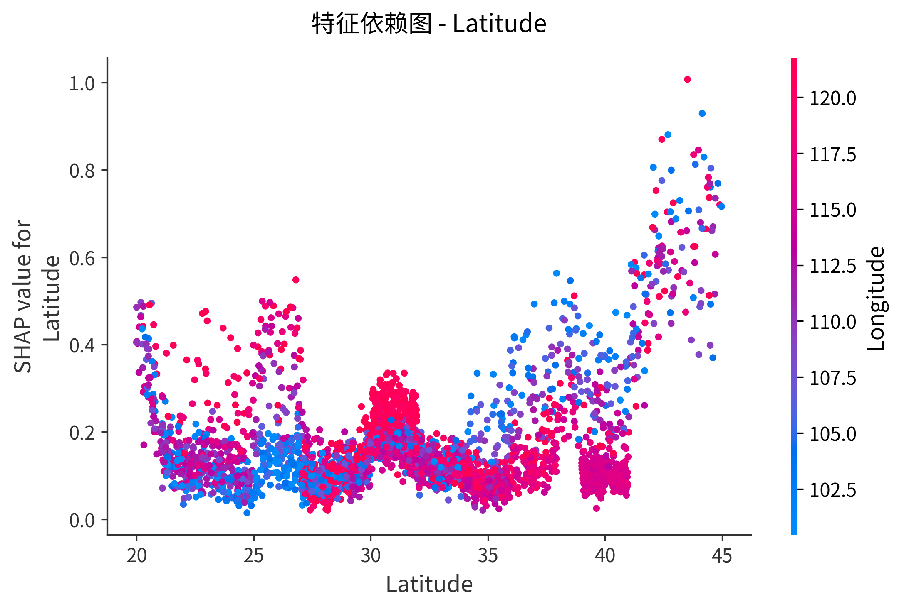
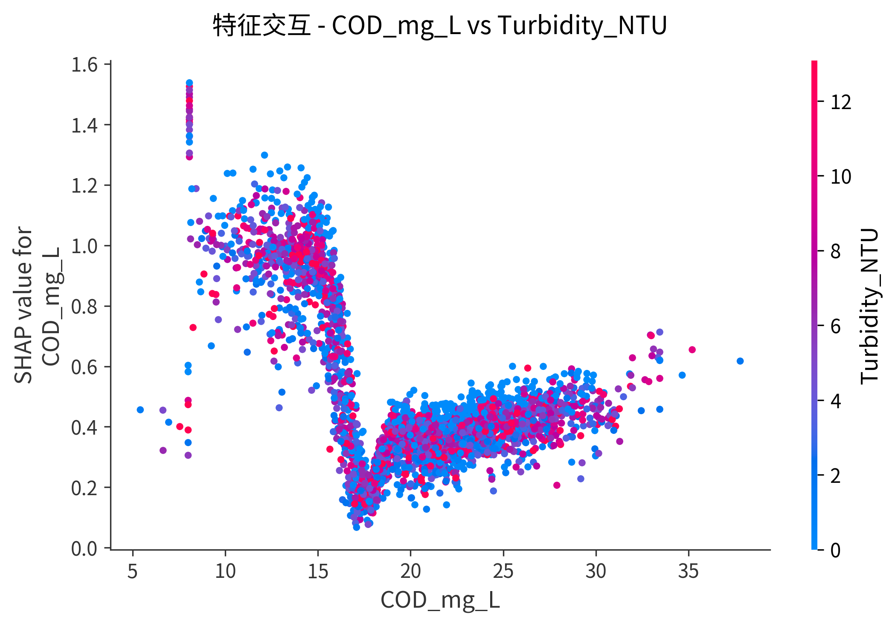
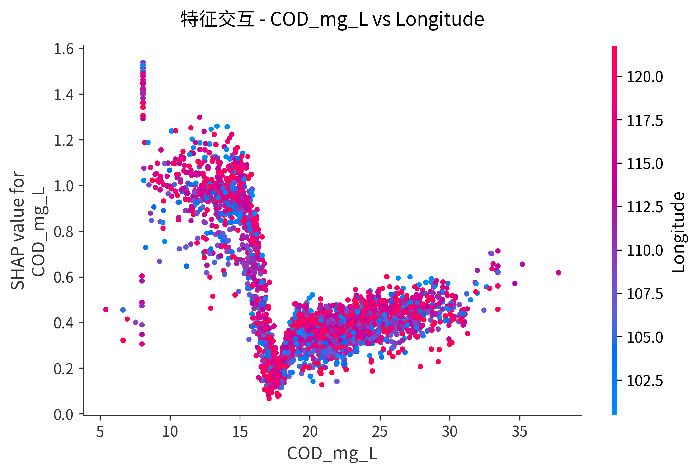
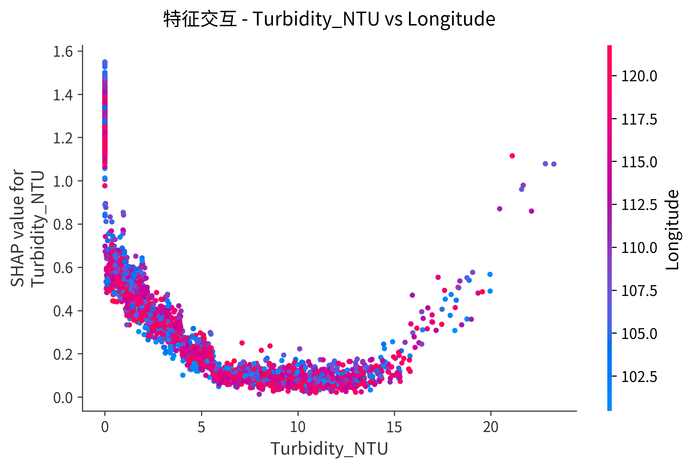
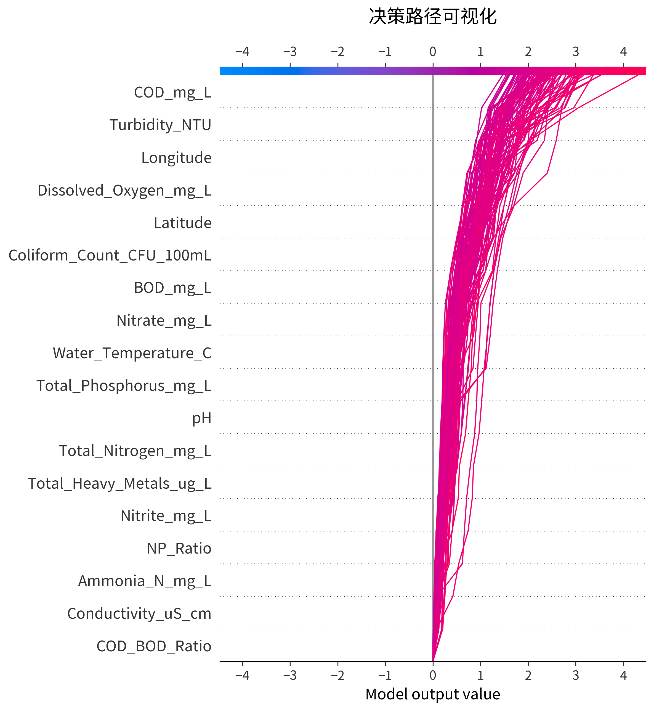

# SHAP可解释性分析报告 - 分类模型

**模型名称**: LightGBM
**生成时间**: 2025-11-19 18:40:03
**测试集样本数**: 3105
**特征数量**: 18
**类别数量**: 5

---

## 1. 全局特征重要性

### 1.1 Summary Plot

**说明**:
- 纵轴：按重要性排序的特征
- 横轴：SHAP值（特征对预测的贡献）
- 颜色：特征值（红色=高，蓝色=低）
- 点分布：展示每个特征对所有样本的影响

### 1.2 Bar Plot

**说明**:
- 展示平均|SHAP值|，即每个特征的平均重要性
- 柱状图越长，特征越重要

---

## 2. 特征交互分析

### 2.1 特征依赖图（Dependence Plots）

#### COD_mg_L

#### Turbidity_NTU

#### Longitude

#### Dissolved_Oxygen_mg_L

#### Latitude

**说明**:
- 横轴：特征值
- 纵轴：SHAP值（该特征对预测的贡献）
- 颜色：交互特征值（自动选择最强交互特征）

### 2.2 特征交互图（Interaction Plots）

展示Top特征之间的交互效应：

#### COD_mg_L vs Turbidity_NTU

#### COD_mg_L vs Longitude

#### Turbidity_NTU vs Longitude

---

## 3. 样本级别解释

为每个污染等级选择3个代表样本，展示其预测的详细分解：

### Excellent

### Good

### Moderate

### Poor

### Very Poor

**说明**:
- 从基线值（expected value）出发
- 每个特征向上推（红色）或向下拉（蓝色）预测值
- 最终到达实际预测值

---

## 4. 决策路径可视化

**说明**:
- 展示100个样本的决策路径
- 每条线代表一个样本
- 从基线值开始，逐个特征累积SHAP值
- 最终到达预测值

---

## 5. 关键发现

### Top 5 最重要特征：

1. **COD_mg_L**
2. **Turbidity_NTU**
3. **Longitude**
4. **Dissolved_Oxygen_mg_L**
5. **Latitude**

### 模型解释性评估：

- **模型类型**: LightGBM（树模型）
- **SHAP支持**: TreeExplainer（高效）
- **特征数量**: 适中，易于解释
- **交互效应**: 已识别主要交互特征对

---

## 6. 使用建议

1. **特征工程**: 关注Top特征，考虑进一步优化
2. **模型优化**: 分析低重要性特征，考虑剔除以简化模型
3. **业务应用**: 使用样本解释向利益相关者解释具体预测
4. **监控重点**: 重点监控Top特征的数据质量
