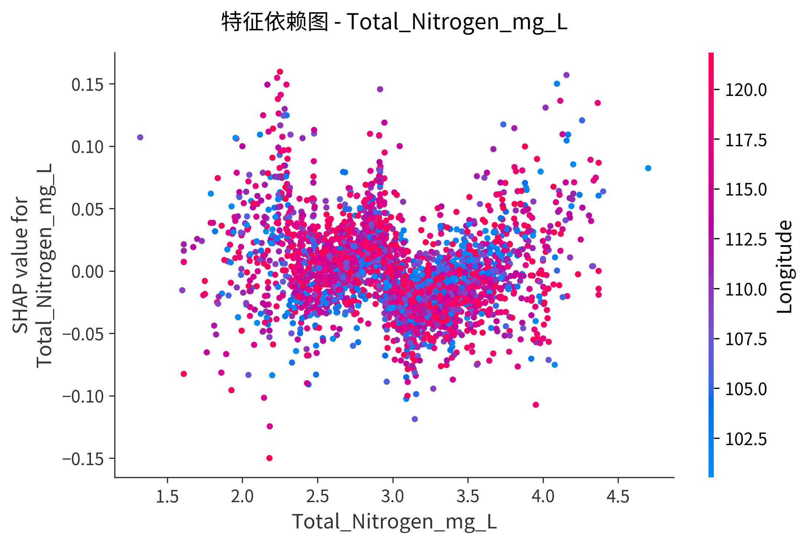
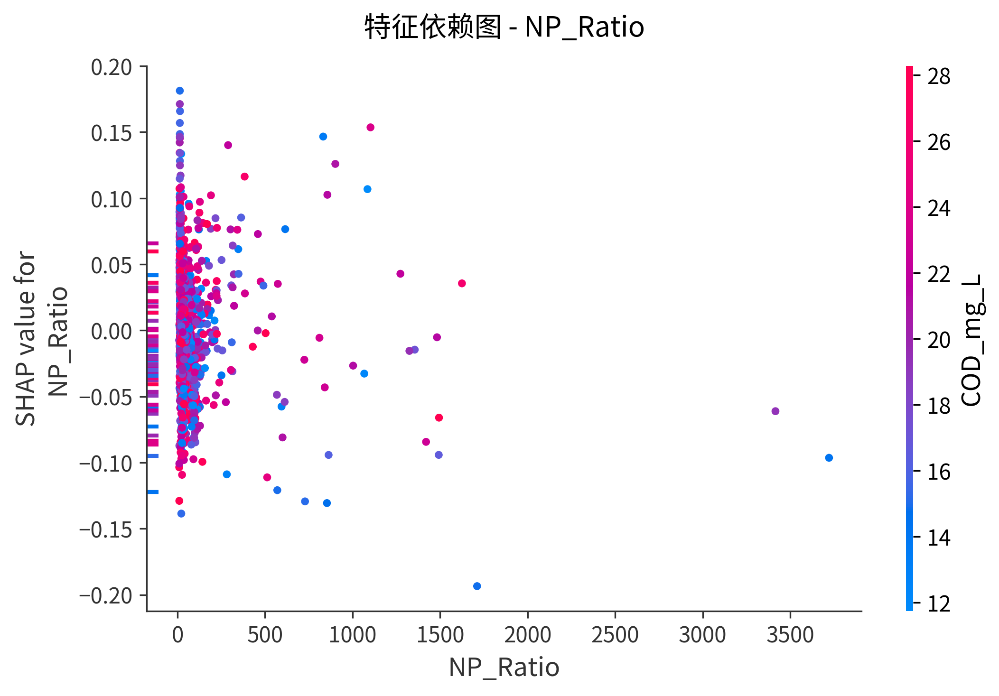
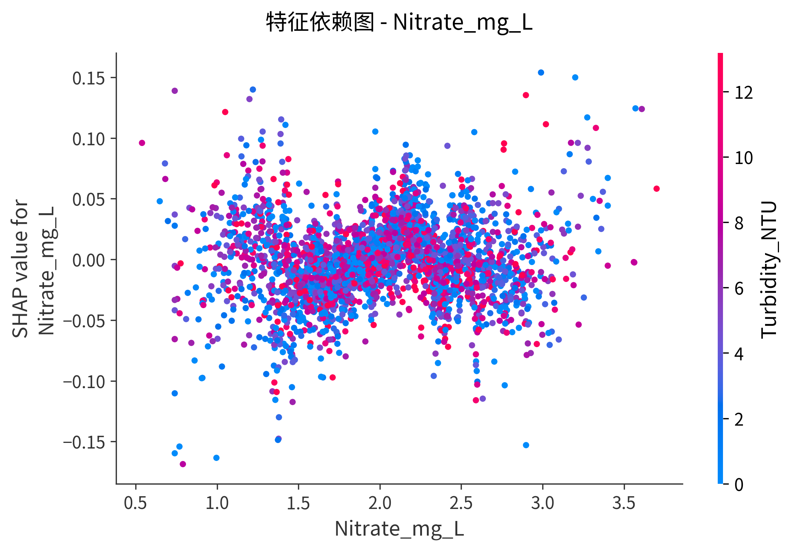
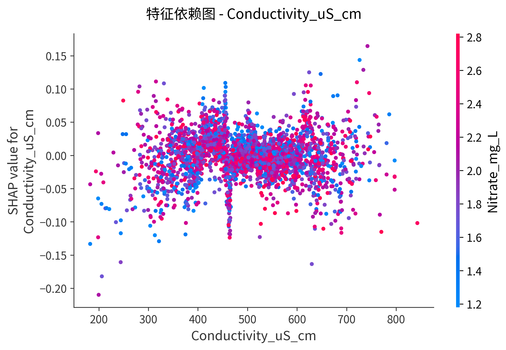
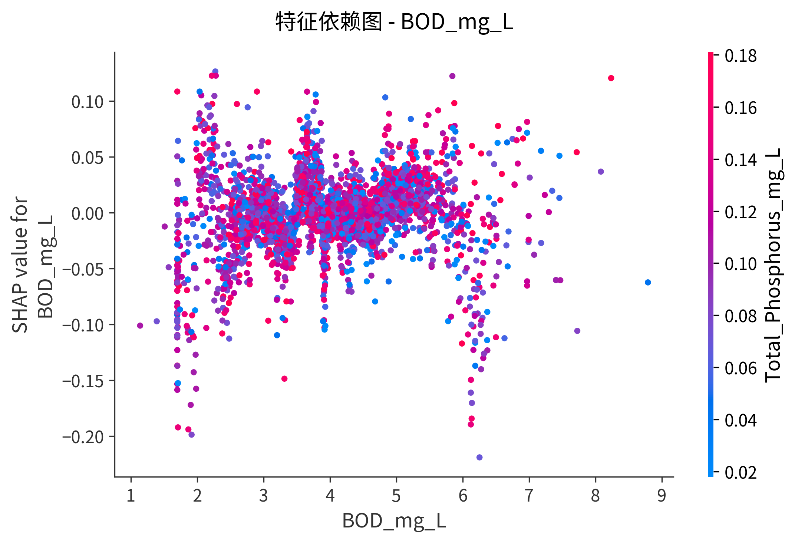
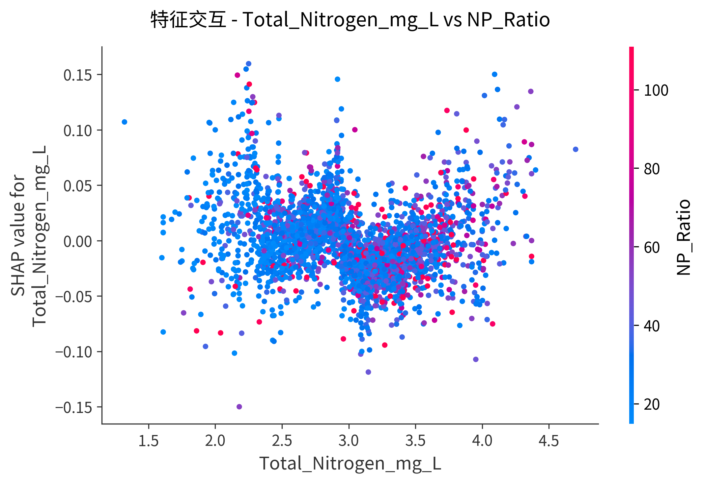
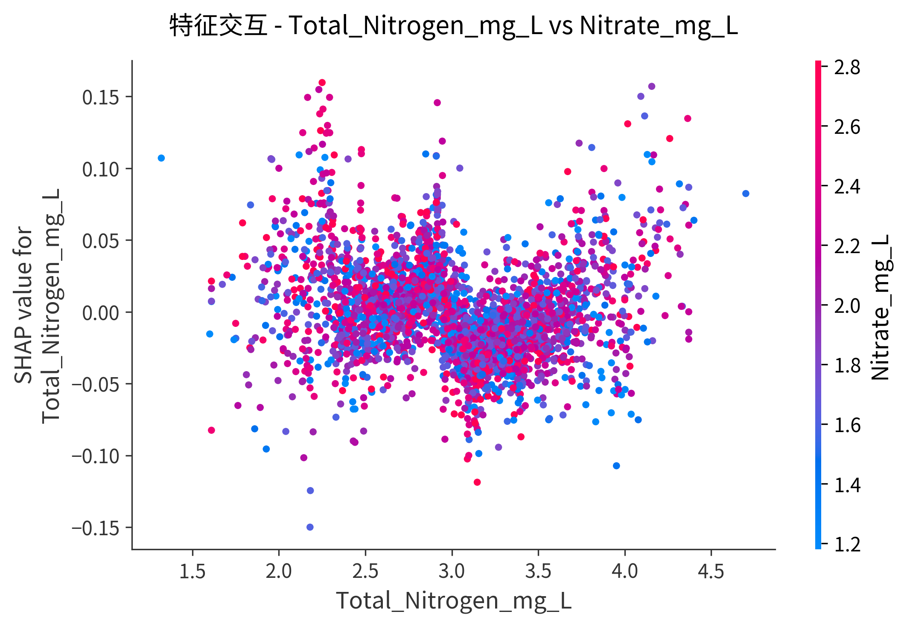
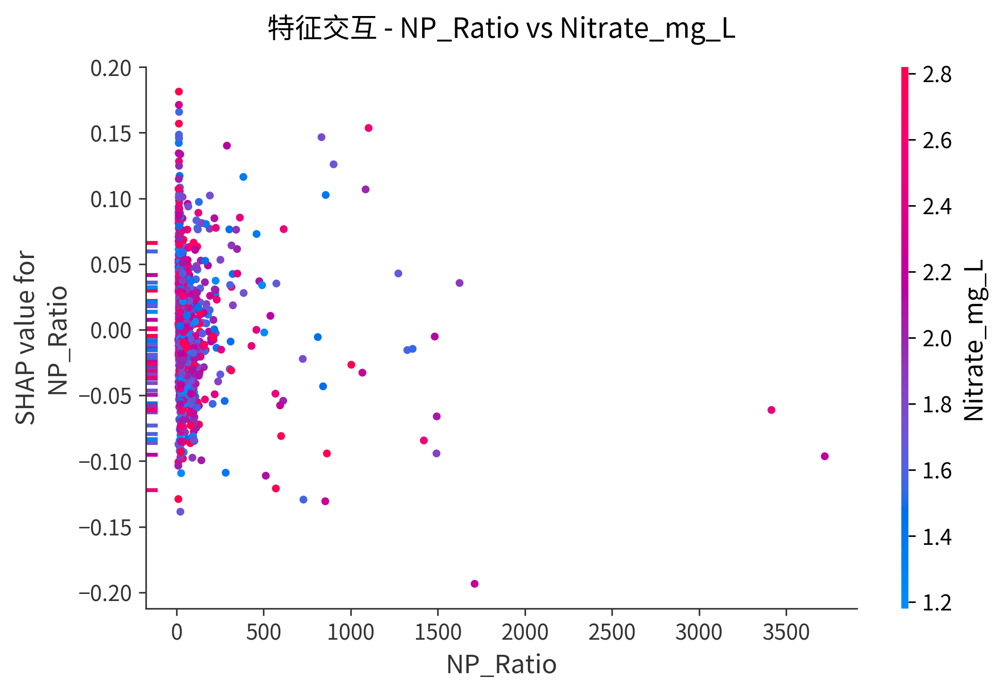
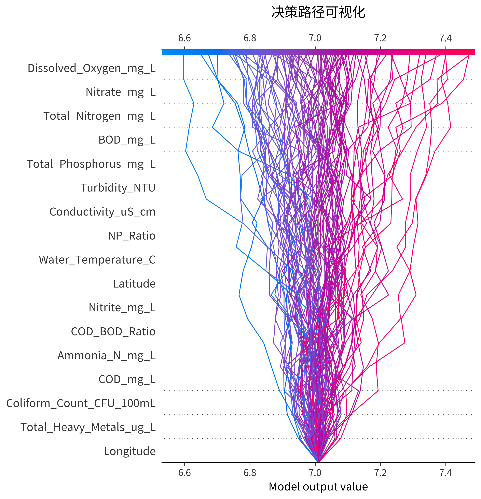

# SHAP可解释性分析报告 - 回归模型

**模型名称**: XGBoost_Regression_Clean
**预测目标**: pH
**生成时间**: 2025-11-19 18:40:08
**测试集样本数**: 3105
**特征数量**: 17

---

## 1. 全局特征重要性

### 1.1 Summary Plot

**说明**:
- 纵轴：按重要性排序的特征
- 横轴：SHAP值（特征对预测值的影响）
- 颜色：特征值（红色=高，蓝色=低）

### 1.2 Bar Plot

---

## 2. 特征交互分析

### 2.1 特征依赖图

#### Total_Nitrogen_mg_L

#### NP_Ratio

#### Nitrate_mg_L

#### Conductivity_uS_cm

#### BOD_mg_L

### 2.2 特征交互图

#### Total_Nitrogen_mg_L vs NP_Ratio

#### Total_Nitrogen_mg_L vs Nitrate_mg_L

#### NP_Ratio vs Nitrate_mg_L

---

## 3. 样本级别解释

按预测值分位数选择代表样本：

### 低值样本

### 中值样本

### 高值样本

---

## 4. 决策路径可视化

---

## 5. 关键发现

### Top 5 最重要特征：

1. **Total_Nitrogen_mg_L**
2. **NP_Ratio**
3. **Nitrate_mg_L**
4. **Conductivity_uS_cm**
5. **BOD_mg_L**

### 注意事项：

⚠️ **数据泄露警告**: 本模型使用清洁版特征（无数据泄露），性能较低但反映真实预测能力。

**适用场景**: 真实性能评估、论文发表、模型对比
