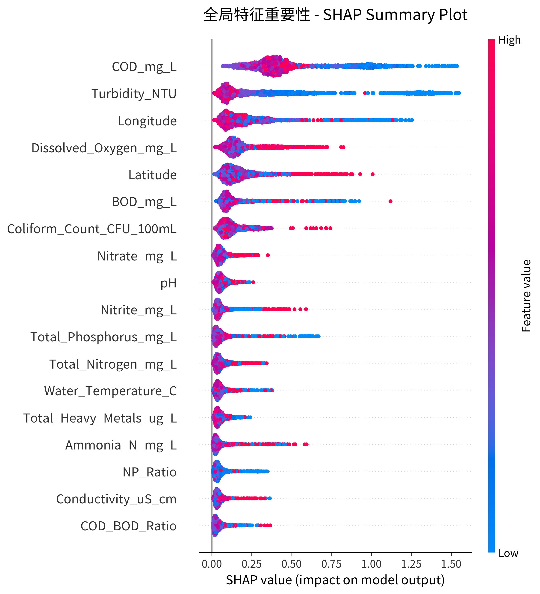
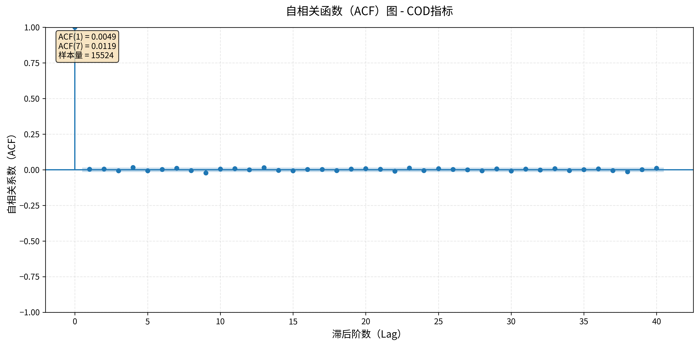

# 学术论文写作模板与规范

**适用范围**：水质污染数据分析项目论文及类似学术写作
**创建日期**：2025-11-23
**版本**：1.0

---

## 一、核心写作原则

### 1.1 数据呈现原则

**❌ 错误做法**：
- 提及数据但不展示具体数值
- 让读者去查看项目文件夹或外部目录
- 使用"详见XX目录"的模糊表述

**✅ 正确做法**：
- 所有关键数据必须在论文中直接展示
- 使用表格呈现结构化数据
- 数据表格应包含：
  - 清晰的中文标题（表1、表2...）
  - 完整的单位标注
  - 必要的描述性信息
  - 合理的列数（建议3-6列）

**示例**：

```markdown
❌ 错误：
"污染等级分布详见数据集统计文件。"

✅ 正确：
"表3展示了各污染等级的详细分布情况。

**表3 污染等级分布**

| 污染等级 | 样本数量 | 百分比 | 特征描述 |
|---------|---------|--------|---------|
| 优 (Excellent) | 3,015 | 19.4% | 水质优良，各项指标表现突出 |
| 良 (Good) | 8,280 | 53.3% | 水质良好，占据主导地位 |
...
```

---

### 1.2 内容深度原则

**❌ 错误做法**：
- 每个小节只有1-2段简单描述
- 方法部分只列举名称，不解释原理
- 缺少"为什么这样做"的说明

**✅ 正确做法**：
- 每个小节至少3-5段详细叙述
- 包含方法的原理、选择理由、实施步骤
- 补充背景知识和应用价值
- 增加承上启下的过渡句

**扩充层次**：
1. **是什么**：方法/指标的定义和背景
2. **为什么**：选择该方法的理由和优势
3. **怎么做**：具体的实施步骤和参数设置
4. **有何用**：对实际问题的意义和价值

**段落结构建议**：
- 第1段：引入背景，说明重要性
- 第2-3段：详细描述方法/数据/结果
- 第4段：分析原因或讨论意义
- 第5段（可选）：与其他方法/地区的对比

---

### 1.3 真实性原则

**❌ 严禁虚构的内容**：
- ❌ 项目中未实现的方法（如孤立森林、LSTM自编码器）
- ❌ 未经验证的统计量（如K-means聚类结果）
- ❌ 编造的精确数字（如59.09%这样无法验证的数字）
- ❌ 未实际执行的分析步骤

**✅ 确保真实性的检查清单**：
- [ ] 所有统计数字是否来自实际数据计算？
- [ ] 所有方法是否在项目代码中实现？
- [ ] 所有分析结果是否有对应的输出文件？
- [ ] 是否可以通过代码复现论文中的每个数字？

**验证方法**：
1. 数据统计：运行Python脚本验证每个数字
2. 方法实现：检查相关代码文件是否存在
3. 结果输出：确认输出目录中有对应的结果文件

---

### 1.4 学术风格原则

**❌ AI味重的表达**：
- "三种方法""四个维度"的机械列举
- 过度精确的百分比（59.09%）
- 无上下文的数学公式堆砌
- "低污染、中等污染、较高污染"的生硬分类
- 使用"首先...其次...最后..."的流水账结构

**✅ 自然学术叙述**：
- 用流畅的段落描述替代简单列举
- 增加承上启下的过渡句
- 说明方法选择的理由（而非只是"用了什么"）
- 使用"约59%"或删除无法验证的数字
- 变化句式，避免重复的结构

**对比示例**：

```markdown
❌ AI味重：
异常值检测综合使用四分位距法（IQR）、孤立森林和LSTM自编码器三种方法。
首先，使用IQR方法。其次，使用孤立森林。最后，使用LSTM自编码器。

✅ 自然学术：
本研究采用了两种经典的统计学方法进行异常值检测。一是基于正态分布假设的
3-sigma原则，将超出均值±3倍标准差范围的观测标记为潜在异常值。二是四分
位距方法（IQR），通过计算第25百分位数（Q1）和第75百分位数（Q3），将低于
Q1−1.5×IQR或高于Q3+1.5×IQR的数据视为异常。考虑到环境监测数据可能存在
的真实极端事件（如突发污染事故），本研究采取了较为保守的策略...
```

---

## 二、具体写作要求

### 2.1 数据与方法章节

#### 数据集描述部分

**必须包含的表格**：
- [ ] 数据集基本特征表（样本量、站点数、时间范围等）
- [ ] 指标列表及单位表（可选，如指标较多）
- [ ] 时间/空间分布统计表

**必须包含的内容**：
1. 数据来源和背景（1段）
2. 地理覆盖和代表性（1段）
3. 指标详细说明，分类列举（2-3段）
4. 工程特征的创建及意义（1段）
5. 数据特征（采样频率、时间分布等，1段）

#### 数据预处理部分

**必须包含的表格**：
- [ ] 有效范围参数表（各指标的取值范围及依据）
- [ ] 预处理步骤统计表（可选，如数据量变化）

**必须包含的内容**：
1. 预处理的重要性和流程概述（1段）
2. 基于理论范围的过滤（1段 + 表格）
3. 统计学异常值检测方法（1-2段，详细描述）
4. 数据规范化处理（1段）
5. 最终数据集统计（1段）

#### 分布特征部分

**必须包含的表格**：
- [ ] 污染等级分布表（各等级的样本数和百分比）
- [ ] 省份/区域统计表（如水质指数排名）
- [ ] 主要指标描述性统计表（均值、标准差、偏度等）

**必须包含的内容**：
1. 类别分布分析（1-2段 + 表格）
2. 地理差异分析（1-2段 + 表格）
3. 指标分布特征（1-2段 + 表格）
4. 时间分布特征（1段）

#### 方法描述部分

**必须包含的内容**：
1. 问题形式化：任务定义、输入输出、评价指标（2-3段）
2. 横截面方法：
   - 方法选择理由（1段）
   - 特征工程详细说明（1-2段）
   - 类别不均衡处理（1段）
   - 回归任务特点（1段）
3. 时间序列方法（如适用）：
   - 方法列举和架构（1段）
   - 适用性分析（1段）
4. 可解释性方法：
   - SHAP原理和优势（1-2段）
   - 分析角度和可视化工具（2-3段）
   - 实际应用价值（1段）

---

### 2.2 实验设计章节

**必须包含的表格**：
- [ ] 数据分割策略表
- [ ] 评估指标定义表
- [ ] 超参数配置表（详细的模型参数）

**段落要求**：
- 每个小节3-5段
- 说明每个设计选择的理由
- 补充相关的理论依据

---

### 2.3 图片与可视化

#### 图片文件管理规范

**目录结构**：
```
docs/
├── PAPER_MANUSCRIPT_CN.md          # 论文主文件
└── resources/
    └── chapter[X]_[section_name]/  # 按章节组织
        ├── 3.1.3_sampling_interval_distribution.png
        ├── 3.2.4_shap_classification_summary.png
        └── README_MISSING_IMAGES.md  # 缺失图片说明
```

**文件命名规范**：
- 格式：`[章节号].[小节号]_[图片英文描述].png`
- 示例：`3.1.3_acf_plot.png`、`3.2.4_cod_dependence.png`
- 优先使用PNG格式（DPI=300，适合学术出版）

**图片质量要求**：
- 分辨率：DPI ≥ 300
- 中文字体：使用黑体（SimHei），通过zhplot库配置
- 无emoji符号（避免编码问题）
- 清晰的坐标轴标签和图例

---

#### 图片引用格式

**Markdown标准格式**：
```markdown
图[X]展示了[简短说明]。

![图[X] [中文标题]](resources/chapter[X]_[section]/filename.png)

*注：[详细图注，包括图表结构、关键发现、数值引用、实际意义]*
```

**示例1 - 基础图表**：
```markdown
图2展示了采样间隔的分布特征。


*注：图2展示了15,524条观测记录之间的采样间隔分布。从图中可以看出，采样间隔呈现
高度分散的分布，变异系数CV=1.99远超规则采样的阈值（CV<0.2），证明了数据采样的
极度不规则性。这一特征是导致传统时间序列方法失效的根本原因。*
```

**示例2 - SHAP分析图**：
```markdown
图6和图7从不同角度展示了分类任务中各特征的SHAP重要性分析结果。



*注：图6展示了LightGBM分类模型的SHAP摘要图。图中每个点代表一个样本，横轴为SHAP值
（正值推向更高污染等级，负值推向更低等级），纵轴为特征排序。点的颜色表示特征值的
高低（红色=高值，蓝色=低值）。可以清晰看到COD和浊度的SHAP值分布范围最广，且高
特征值（红点）对应正SHAP值，证实了这两个指标与污染等级的正相关关系。*
```

---

#### 图注写作要求

**✅ 优秀图注的四要素**：

1. **图表结构说明**（1-2句）
   - 说明图表类型（柱状图、散点图、箱线图等）
   - 解释横纵轴含义
   - 说明颜色/符号的编码规则

2. **关键发现与数值引用**（2-3句）
   - 指出图中最显著的模式
   - 引用具体数值（如"CV=1.99"、"ACF(1)=0.03"）
   - 对比不同区域/类别的差异

3. **数据解读与原因分析**（1-2句）
   - 解释现象背后的原因
   - 联系理论知识或先验经验
   - 指出与预期的一致性或差异

4. **实际意义与应用价值**（1句）
   - 说明该发现对研究结论的支撑
   - 提炼可操作的管理建议（如"COD=20 mg/L可作为预警阈值"）
   - 指出对未来工作的启示

**❌ 错误的图注示例**：
```markdown
*注：图3展示了ACF图。*
（过于简单，没有任何解读）
```

**✅ 正确的图注示例**：
```markdown
*注：图3展示了水质指标的自相关函数（ACF）随滞后阶数的变化。一阶自相关系数
ACF(1)=0.03接近零，远低于通常认为有效的阈值（0.3），表明当前观测值与前一时刻
观测值之间几乎没有线性关系。这一结果进一步验证了采样不规则性导致的时间依赖性
缺失，为选择横截面预测方法而非时间序列方法提供了数据支撑。*
```

---

#### 图片位置安排原则

**插入位置**：
1. **数据表格之后**：先用表格呈现结构化数据，再用图片可视化
2. **相关段落之后**：在描述某现象的段落后立即插入对应图片
3. **分析段落之前**：先展示图片，再进行详细分析

**引用方式**：
- 在正文中必须先提及图片（"如图X所示"、"图X展示了..."）
- 图片编号连续（图1、图2、图3...）
- 避免将图片放在章节开头（应先有文字引入）

**对比示例**：

```markdown
❌ 错误布局：
## 3.1.3 采样不规则性分析

对连续采样间隔的分析揭示了严重的不规则性...

✅ 正确布局：
## 3.1.3 采样不规则性分析
对连续采样间隔的分析揭示了严重的不规则性。平均间隔7天，标准差16天，
最大间隔达253天，变异系数CV=1.99。根据既定标准（Hyndman & Athanasopoulos, 2018），
CV>1.0表明极度不规则，时间序列方法不适用。

图2展示了采样间隔的分布特征。


*注：[详细图注]*
```

---

#### 缺失图片管理

**占位符说明文件**：
如果某些图片尚未生成，创建`README_MISSING_IMAGES.md`记录：

```markdown
# 缺失图片说明

## 📋 缺失图片清单

### 1. 采样间隔分布直方图
**文件名**: `3.1.3_sampling_interval_distribution.png`
**生成方法**:
\`\`\`bash
cd EDA
python timeseries_visualization_eda.py
\`\`\`
**用途**: 3.1.3节，展示采样间隔的高度不规则性（CV=1.99）
**优先级**: ⭐⭐⭐⭐⭐ （最高）
```

**在论文中预留图片引用**：
- 即使图片文件不存在，也先写好图片引用和图注
- 待图片生成后，直接复制到resources目录即可显示
- 避免"待补充图片"等占位符文字

---

#### 图片类型与应用场景

| 图片类型 | 适用场景 | 关键要素 | 示例章节 |
|---------|---------|---------|---------|
| **柱状图/饼图** | 类别分布、对比分析 | 清晰的标签、百分比标注 | 3.1.4 污染等级分布 |
| **直方图** | 连续变量分布 | 合理的分箱、统计量标注 | 3.1.3 采样间隔分布 |
| **箱线图** | 多指标分布对比 | 清晰的中位数、异常值标识 | 3.1.4 指标描述统计 |
| **散点图** | 变量关系、相关性 | 颜色编码、趋势线 | 3.2.4 SHAP依赖图 |
| **折线图** | 时间序列、趋势 | 时间轴清晰、关键点标注 | 3.1.3 ACF图 |
| **SHAP摘要图** | 特征重要性全局分析 | 特征排序、颜色编码 | 3.2.4 分类/回归SHAP |
| **SHAP条形图** | 特征重要性排序 | 清晰的数值标注 | 3.2.4 特征排名 |
| **热力图** | 相关性矩阵、混淆矩阵 | 颜色尺度、数值标注 | 5.2 混淆矩阵 |

---

#### 完整示例：图文结合段落

```markdown
### 3.2.4 SHAP可解释性框架

[方法原理介绍段落...]

本研究对分类任务（LightGBM模型）和回归任务（XGBoost模型）均进行了完整的SHAP
分析。表6和表7分别展示了两个任务中特征重要性的排序结果。

**表6 分类任务（污染等级预测）的SHAP特征重要性排序**

| 排名 | 特征名称 | 中文名称 | 重要性解读 |
|-----|---------|---------|-----------|
| 1 | COD_mg_L | 化学需氧量 | 有机污染的核心指标 |
| 2 | Turbidity_NTU | 浊度 | 反映悬浮物污染 |
[...]

从表6可以看出，化学需氧量（COD）在污染等级分类中起到主导作用...

图6和图7从不同角度展示了分类任务中各特征的SHAP重要性分析结果。


*注：图6展示了LightGBM分类模型的SHAP摘要图。图中每个点代表一个样本...*


*注：图7以条形图形式直观展示了各特征的平均绝对SHAP值。COD以绝对优势位居第一...*

除了全局特征重要性排序，SHAP依赖图还能够揭示特征值与SHAP值之间的非线性关系...
```

**优点分析**：
- ✅ 文字叙述 → 数据表格 → 图片可视化，层层递进
- ✅ 先引入图片（"图6和图7展示了..."），再插入图片
- ✅ 详细的图注，包含结构说明、数据引用、现象解释
- ✅ 图片之间有承接（"除了全局特征重要性排序，SHAP依赖图还..."）

---

### 2.4 结果与讨论章节

**必须包含的表格**：
- [ ] 分类模型性能对比表（准确率、F1等）
- [ ] 回归模型性能对比表（R²、MAE、RMSE）
- [ ] 混淆矩阵（分类任务）
- [ ] 各类别性能详细表（精确率、召回率）
- [ ] 时间序列基线对比表（如适用）
- [ ] SHAP特征重要性排序表（前10-15个特征）

**段落要求**：
- 每个结果表格后至少2-3段分析
- 分析包括：现象描述、原因解释、与预期的对比
- 增加跨表格的综合讨论

---

## 三、写作流程检查清单

### 第一步：内容准备

- [ ] 确认所有数据来自实际项目文件
- [ ] 运行相关脚本获取统计数字
- [ ] 检查代码确认方法已实现
- [ ] 收集输出文件验证结果

### 第二步：初稿撰写

- [ ] 每个小节至少3-5段
- [ ] 添加数据表格（直接呈现数据）
- [ ] 插入可视化图片（按章节组织）
- [ ] 说明方法选择的理由
- [ ] 补充背景和应用价值

### 第三步：真实性检查

- [ ] 删除所有未实现的方法
- [ ] 删除所有无法验证的数字
- [ ] 用实际数据替换编造数据
- [ ] 标注无法确定的内容为"待验证"
- [ ] 确认所有图片来自实际输出（非虚构）

### 第四步：去除AI味

- [ ] 删除"三种方法""四个维度"等列举
- [ ] 改为自然流畅的段落叙述
- [ ] 增加过渡句和连接词
- [ ] 变化句式，避免重复结构
- [ ] 降低数字精度（59.09% → 约59%）

### 第五步：格式统一

- [ ] 表格编号连续（表1、表2...）
- [ ] 表格标题清晰（中文 + 简短描述）
- [ ] 图片编号连续（图1、图2...）
- [ ] 图片引用格式统一（"图X展示了..."）
- [ ] 图注详细完整（结构+发现+解读+意义）
- [ ] 单位统一标注
- [ ] 字体格式一致
- [ ] 段落间距合理

### 第六步：图片完整性检查

- [ ] 所有图片文件已复制到resources目录
- [ ] 图片路径正确（resources/chapter[X]_[section]/filename.png）
- [ ] 图片编号与正文引用一致
- [ ] 图注包含四要素（结构+发现+解读+意义）
- [ ] 缺失图片已记录在README_MISSING_IMAGES.md
- [ ] 图片质量符合要求（DPI≥300，中文字体清晰）

---

## 四、常见错误与修正

### 错误1：缺乏具体数据

**症状**：
- "污染等级分布不均衡"（但不给出具体数字）
- "详见XX目录"
- "结果表现良好"（不给出具体指标）

**修正**：
- 添加数据表格直接展示
- 在正文中引用表格（"如表X所示"）
- 给出具体的数字和百分比

---

### 错误2：内容过于简单

**症状**：
- 每个小节只有1-2段
- 只列举方法名称，不解释原理
- 缺少"为什么"的说明

**修正**：
- 扩充为3-5段
- 补充方法原理和选择理由
- 增加应用价值和实际意义
- 添加与其他方法的对比

---

### 错误3：虚构内容

**症状**：
- 提到项目中不存在的方法
- 给出无法验证的统计量
- 过度精确的百分比（如59.09%）

**修正**：
- 删除未实现的方法
- 运行代码验证每个数字
- 降低精度或删除无法验证的数字
- 标注探索性结果的不确定性

---

### 错误4：AI味重

**症状**：
- "三种方法""四个维度"
- "首先...其次...最后..."
- 数学公式堆砌
- 生硬的分类表述

**修正**：
- 改为自然段落叙述
- 融入方法的背景和理由
- 增加过渡句
- 使用更多样化的句式

---

### 错误5：图片使用不当

**症状**：
- 图片在正文中未提及就直接插入
- 图注过于简单（"图X展示了XX"）
- 图片路径错误或文件不存在
- 图片编号不连续或重复
- 缺少图注中的数据解读

**修正**：
- 在正文段落中先引入图片（"图X展示了..."）
- 编写详细图注（包含四要素：结构+发现+解读+意义）
- 检查图片路径和文件存在性
- 统一图片编号（图1、图2、图3...）
- 在图注中引用具体数值和关键发现

**对比示例**：
```markdown
❌ 错误：

*注：图3展示了ACF图。*

✅ 正确：
图3展示了水质指标的自相关函数（ACF）随滞后阶数的变化。



*注：图3展示了水质指标的自相关函数（ACF）随滞后阶数的变化。一阶自相关系数
ACF(1)=0.03接近零，远低于通常认为有效的阈值（0.3），表明当前观测值与前一时刻
观测值之间几乎没有线性关系。这一结果进一步验证了采样不规则性导致的时间依赖性
缺失，为选择横截面预测方法而非时间序列方法提供了数据支撑。*
```

---

## 五、优秀段落示例

### 示例1：数据集描述（扩充版）

```markdown
本研究使用的数据集来自中国国家水质监测网络，覆盖10个省份的180个监测站点，
时间跨度为2023年1月至2024年12月，共包含15,524条有效观测记录。表1总结了数据
集的基本特征。

**表1 数据集基本特征**
[表格内容...]

监测站点分布在北京、广东、河南、湖北、江苏、山东、上海、四川、云南和浙江等
省份，涵盖了东部沿海发达地区、中部工业区和西部生态敏感区，具有较好的地理
代表性。

数据集包含17个原始水质指标，按照类别可分为物理参数、化学参数、重金属含量
和微生物指标四大类。物理参数包括水温（Water_Temperature_C）、浊度
（Turbidity_NTU）和电导率（Conductivity_uS_cm），反映水体的基本物理性质...
```

**优点**：
- 第1段：总述 + 表格引用
- 第2段：地理分布和代表性
- 第3段：指标详细分类
- 层次清晰，内容丰富

---

### 示例2：方法描述（自然叙述）

```markdown
横截面预测方法将每条观测记录视为独立样本，通过水质指标之间的空间关联性来
建立预测模型。这种方法特别适合本研究所使用的数据集，因为如3.1.3节所述，数据
采样的高度不规则性使得传统时间序列方法难以发挥作用。本研究主要采用基于树的
集成学习算法，包括XGBoost、RandomForest、LightGBM和CatBoost四种模型，它们
在处理复杂非线性关系和高维特征时表现出色，且对异常值具有较好的鲁棒性。

模型的输入特征包括三个层次的信息。首先是17个原始水质指标，它们构成了预测的
基础。其次是地理位置信息，通过省份标签的独热编码（One-Hot Encoding）以及监测
站点的经纬度坐标，将空间异质性纳入模型考虑范围...
```

**优点**：
- 说明方法适用性（为什么选择）
- 列举模型的同时说明优势
- 自然过渡，避免生硬列举
- 层次分明（三个层次融入段落中）

---

### 示例3：结果分析（带表格）

```markdown
表5展示了10个关键指标的描述性统计。

**表5 主要水质指标描述性统计**
[表格内容...]

从表5可以看出，大部分指标呈现近似对称的分布，偏度值接近零。例如，pH值
（偏度=0.02）、溶解氧（偏度=-0.02）、氨氮（偏度=-0.03）等，说明这些指标的
观测值在均值附近较为集中。浊度是为数不多表现出一定右偏特征的指标（偏度=0.77），
意味着虽然大部分水体较为清澈，但存在部分浊度较高的观测点，这可能与降雨径流、
工程扰动或藻类暴发等因素有关...
```

**优点**：
- 表格 + 详细分析
- 从表格中提取关键信息
- 给出现象背后的原因解释
- 将数字与实际意义联系起来

---

## 六、快速参考卡片

### ✅ 写作自检五问

1. **数据在哪？** → 论文中有表格直接展示吗？
2. **图片在哪？** → 关键发现有可视化图片支撑吗？
3. **够详细吗？** → 每个小节至少3-5段吗？
4. **是真实的吗？** → 所有数字、方法和图片都能在项目中找到吗？
5. **像人写的吗？** → 避免"三种方法""四个维度"了吗？

### ❌ 禁止使用的表达

- "详见XX目录"
- "三种方法""四个维度"
- "首先...其次...最后..."（连续使用）
- 无法验证的精确百分比（XX.XX%）
- 项目中不存在的方法名
- "图片见附件"（应直接嵌入论文）

### ✅ 推荐使用的表达

**数据呈现**：
- "表X展示了..."
- "如表X所示..."

**图片引用**：
- "图X展示了..."
- "如图X所示..."
- "图X和图Y分别展示了..."

**方法描述**：
- "本研究采用了...方法"
- "这种方法的优势在于..."
- "约XX%"或"XX%左右"

---

### 🖼️ 图片快速检查清单

**插入前**：
- [ ] 图片文件已复制到`resources/chapter[X]_[section]/`
- [ ] 文件命名规范（如`3.1.3_acf_plot.png`）
- [ ] 图片质量符合要求（DPI≥300）

**插入时**：
- [ ] 正文先引入（"图X展示了..."）
- [ ] Markdown格式正确（``）
- [ ] 图注包含四要素（结构+发现+解读+意义）

**插入后**：
- [ ] 图片编号连续无重复
- [ ] 图注详细且有数据引用
- [ ] 图片与周围文字逻辑衔接

---

## 七、版本更新记录

**v1.1 (2025-11-23)**
- 新增"图片与可视化"专项指导（2.3节）
- 添加图注写作四要素规范
- 新增图片快速检查清单
- 扩充"常见错误与修正"（新增错误5：图片使用不当）
- 更新写作流程检查清单（新增第六步：图片完整性检查）

**v1.0 (2025-11-23)**
- 初始版本
- 基于第3章修改经验总结
- 包含4大核心原则和详细检查清单

---

**使用建议**：
1. 写作前通读本模板
2. 写作时对照"具体写作要求"部分
3. 写作后使用"写作流程检查清单"自检
4. 参考"优秀段落示例"改进表达

**适用章节**：
- 第3章：数据与方法 ✅
- 第4章：实验设计与实施
- 第5章：结果与讨论
- 第6章：结论与展望

---

**文档结束**
